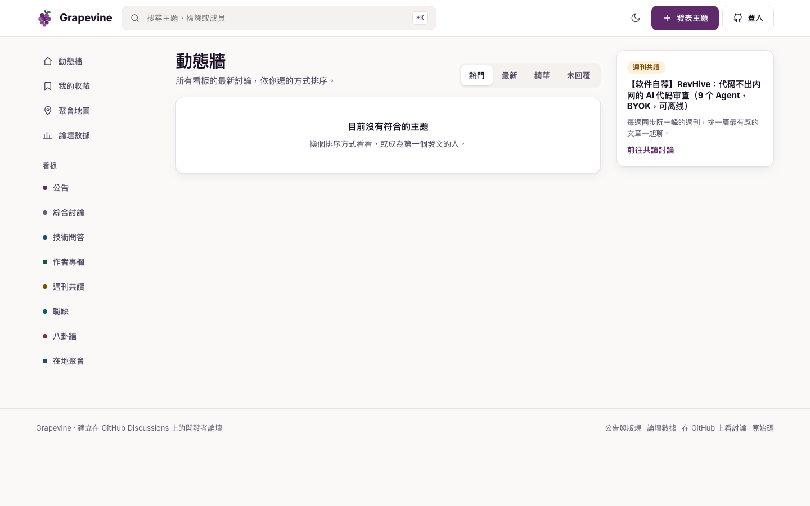
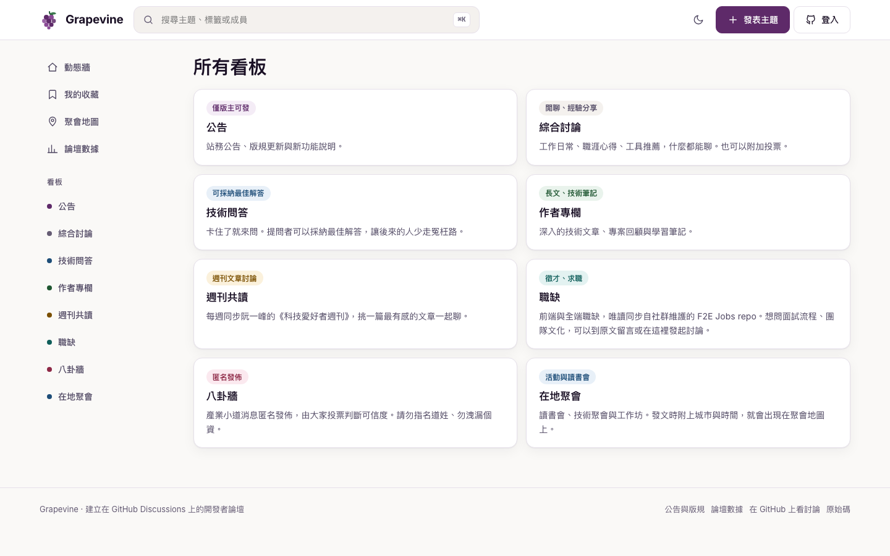
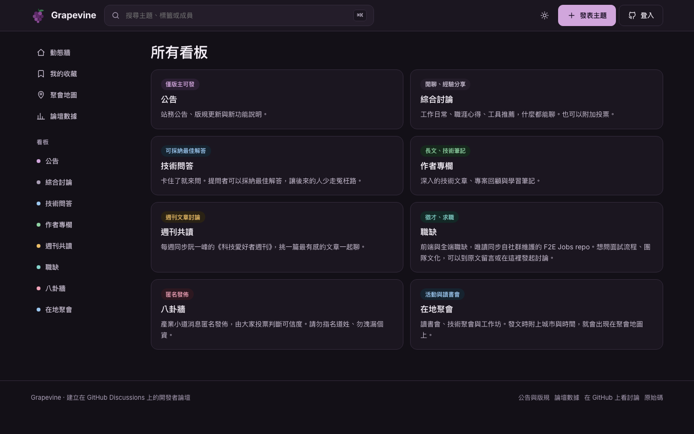
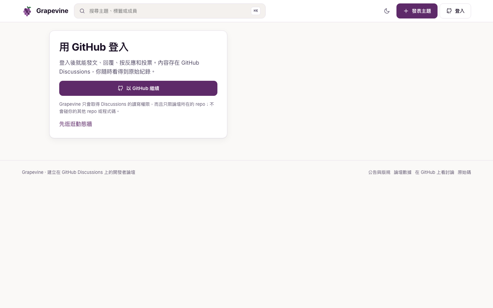
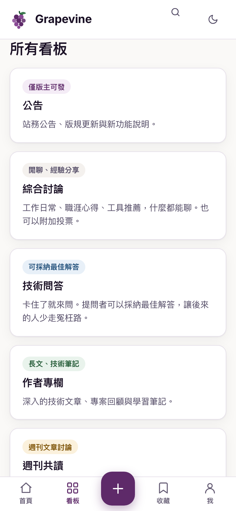

# Grapevine

建立在 **GitHub Discussions** 上的開發者論壇：技術問答、作者專欄、週刊共讀、職缺、匿名八卦牆與在地聚會。
以 **Next.js 16（App Router）** 打造，主題頁與看板頁在伺服器端渲染，方便搜尋引擎收錄。

**網站入口：<https://grapevine-six-gr925.vercel.app/>**



## 目前狀態

> 以下是 2026-11-26 的快照。

- 正式站讀取論壇 repo 的 GitHub Discussions，會員可以用 GitHub 登入。
- 作者專欄、週刊共讀、職缺、八卦牆、在地聚會這 5 個看板對應的 Discussions 分類還沒建立，
  看板上會顯示提示並暫停發文；週刊共讀與職缺的同步內容照常顯示。
- 匿名八卦牆目前**只能投票、不能發文**，要等設定代發用的 bot 帳號。
- 本機或 CI 沒有設定 GitHub 時，會改用內建的**範例資料**（頁面頂端有提示條），寫入動作只做檢查、不會儲存。

## 畫面

| 所有看板 | 深色模式 |
|---|---|
|  |  |

| 登入 | 手機版動態牆 | 手機版看板 |
|---|---|---|
|  |  |  |

截圖取自正式站，用未登入的瀏覽器擷取；刻意避開會顯示其他使用者名稱或頭像的頁面。

## 功能

| 頁面 | 路徑 | 說明 |
|---|---|---|
| 動態牆 | `/` | 所有看板的主題，可依熱門／最新／精華／未回覆排序；右欄有本週活躍、熱門標籤、週刊共讀、下一場聚會 |
| 看板 | `/c/[slug]` | 8 個看板，各對應一個 Discussions 分類；職缺看板有地點與類型篩選，八卦牆有可信度投票（👍／👎），在地聚會連到地圖 |
| 同步文章 | `/c/[slug]/[number]` | 週刊共讀（ruanyf/weekly）與職缺（f2etw/jobs）同步過來的唯讀內容，留言在 GitHub 原文 |
| 主題 | `/t/[number]` | Markdown 內文、反應、投票、巢狀回覆（可直接回覆某則留言、對留言按推）、相關主題；問答看板的提問者可以採納或取消採納解答；含 JSON-LD 與 Open Graph |
| 發表主題 | `/new` | 選看板、Markdown 編輯與預覽、標籤，聚會可填城市／時間／地點；草稿存在本機。需要先登入（GitHub API 不能建立投票，所以沒有投票選項） |
| 個人頁 | `/u/[login]` | 等級與進度、統計、近半年參與熱度圖、徽章（全部由真實活動計算） |
| 搜尋 | `/search` | 關鍵字或 `?tag=` 標籤搜尋；任何頁面按 ⌘K／Ctrl+K 會聚焦搜尋框 |
| 收藏 | `/bookmarks` | 只存在這台裝置的瀏覽器（localStorage） |
| 聚會地圖 | `/meetups` | Leaflet 地圖與聚會列表 |
| 論壇數據 | `/stats` | 每週新主題、回覆、首次回覆時間、問答解決率 |
| 所有看板 | `/boards` | 看板總覽（手機底部分頁的「看板」） |
| 登入 | `/login` | 用 GitHub App 登入；已登入時顯示帳號與登出 |

另外：深色模式（跟隨系統，可手動切換且不閃爍）、手機版底部分頁列、`sitemap.xml`、`robots.txt`，
以及 v1 舊網址的永久轉址（設定在 `next.config.ts`）。

## 快速開始

需要 Node.js 20.9 以上。

```bash
npm install
npm run dev
```

打開 http://localhost:3000 。不需要任何密鑰，沒有設定 GitHub 時會自動使用範例資料。
要接上真實資料與登入，把 `.env.example` 複製成 `.env.local` 並照 [DEPLOY.md](./DEPLOY.md) 的步驟填值。

| 指令 | 用途 |
|---|---|
| `npm run dev` | 開發伺服器 |
| `npm run build` | 正式建置（CI 的硬性關卡） |
| `npm run lint` | ESLint |
| `npm run typecheck` | TypeScript 型別檢查 |
| `npm test` | Vitest 單元測試（含本 README 的結構檢查） |
| `npm run check:setup` | 檢查 `.env.local`、GitHub 連線與 Discussions 分類是否就緒（不會印出密鑰） |

環境變數範本在 `.env.example`，各變數的用途與取得方式見 [DEPLOY.md](./DEPLOY.md)。

## 專案結構

```
src/
├── app/                       # 路由（App Router）
│   ├── layout.tsx             # 根版面：頂欄、範例資料提示、頁尾、手機分頁列、防閃爍的主題腳本
│   ├── globals.css            # 設計系統 token（淺色／深色）與共用元件樣式
│   ├── actions.ts             # Server Actions：發文、回覆、反應、投票、採納解答、登出（匿名發文尚未開放）
│   ├── error.tsx              # 頁面錯誤畫面（例如 GitHub 暫時無回應）
│   ├── not-found.tsx          # 404 頁
│   ├── page.tsx               # 動態牆
│   ├── c/[slug]/page.tsx      # 看板（含職缺篩選、八卦牆、聚會列表）
│   ├── c/[slug]/[number]/page.tsx # 同步文章（週刊、職缺）
│   ├── t/[number]/page.tsx    # 主題頁
│   ├── u/[login]/page.tsx     # 個人頁
│   ├── new/page.tsx           # 發表主題
│   ├── search/page.tsx        # 搜尋
│   ├── bookmarks/page.tsx     # 本機收藏
│   ├── meetups/page.tsx       # 聚會地圖
│   ├── stats/page.tsx         # 論壇數據
│   ├── boards/page.tsx        # 所有看板
│   ├── login/page.tsx         # 登入頁
│   ├── api/auth/login/route.ts    # 開始 GitHub App 登入（state 防 CSRF）
│   ├── api/auth/callback/route.ts # GitHub 回呼：換 token、建立加密 session
│   ├── sitemap.ts             # sitemap.xml
│   └── robots.ts              # robots.txt
├── components/
│   ├── Icon.tsx               # 線條圖示與 Logo
│   ├── layout/                # 頂欄、側邊看板導覽、手機分頁列、三欄版型、深色模式切換、搜尋框
│   └── forum/                 # 主題卡片、動態牆、側欄小工具、互動元件、發文表單、聚會地圖
└── lib/
    ├── config.ts              # 伺服器端環境變數（論壇 repo、GitHub App）
    ├── session.ts             # 加密的 session cookie（jose JWE）與 token 自動續期
    ├── boards.ts              # 看板設定（對應 Discussions 分類）
    ├── levels.ts              # 等級與徽章計算
    ├── format.ts              # 日期與頭像格式化
    ├── bookmarks.ts           # 本機收藏
    ├── github/
    │   ├── graphql.ts         # GitHub GraphQL／REST 請求
    │   ├── oauth.ts           # GitHub App 使用者授權與 token 續期
    │   └── return-to.ts       # 登入後導回的路徑檢查（防 open redirect）
    └── forum/
        ├── index.ts           # 頁面唯一的資料入口（"use cache" + cacheLife）
        ├── types.ts           # 論壇資料模型與 adapter 介面
        ├── query.ts           # 排序與篩選（熱門分數等）
        ├── github.ts          # GitHub Discussions adapter（讀取）
        ├── github-write.ts    # GitHub Discussions 寫入（用會員自己的 token）
        ├── meta.ts            # 藏在內文裡的標籤／聚會資訊、摘要
        ├── mirror.ts          # 同步看板（週刊、職缺）的 issue 轉換
        └── fixtures.ts        # 範例資料 adapter
scripts/
├── check-setup.mjs            # npm run check:setup
└── update-build-info.mjs      # 每日部署更新 public/build-info.json
test/                          # Vitest 測試
docs/
└── screenshots/               # README 用的正式站截圖
```

## 資料架構

頁面只透過 `src/lib/forum/index.ts` 讀資料。那裡的每個函式都用 `"use cache"` 加上 `cacheLife`，
由 Next.js 負責預先渲染與重新驗證，再交給 adapter（`ForumAdapter`，定義在 `types.ts`）。

- **GitHub Discussions adapter**（`github.ts`）：設定 `GITHUB_FORUM_REPO` 與 `GITHUB_READ_TOKEN` 時啟用。
  看板對應 Discussions 分類（`boards.ts` 的 `discussionCategory`），分類不存在的看板會顯示提示並暫停發文。
  推＝upvote、有幫助＝🎉、感謝＝❤️；八卦牆的可信／存疑＝👍／👎，且一律不顯示作者；精華＝5 個以上 upvote。
  標籤與聚會資訊存在內文結尾的 HTML 註解（`meta.ts`），因為一般會員沒有權限替 Discussions 加 label。
- **寫入**（`github-write.ts` + `app/actions.ts`）：一律用登入會員自己的 GitHub App token，所以在 GitHub 上顯示為本人；
  寫入後用 `updateTag` 讓相關快取立即更新。
- **範例資料 adapter**（`fixtures.ts`）：沒有設定 GitHub 時使用，時間以固定時刻計算，排序結果穩定。
- **登入**：GitHub App 的使用者授權。token 只能操作安裝了 App 的論壇 repo，存在用 `SESSION_SECRET` 加密的 httpOnly cookie，
  過期前自動續期。

## 安全

- **密鑰只在伺服器端**：所有環境變數都沒有 `NEXT_PUBLIC_` 前綴，不會進入瀏覽器的程式碼；
  `src/lib/config.ts` 與 `session.ts` 標記為 `server-only`。
- **最小權限**：會員登入不要求任何 OAuth scope，token 只能在安裝了 GitHub App 的論壇 repo 讀寫 Discussions；
  伺服器的讀取 token 只需要公開 repo 的唯讀權限。
- **Session**：token 用 `SESSION_SECRET` 加密（JWE）後存在 httpOnly、SameSite=Lax 的 cookie（正式環境另加 Secure）；
  登入流程用 `state` 防 CSRF，登入後的導回路徑只接受站內路徑（`return-to.ts`）。
- **內容**：Markdown 經過 `rehype-sanitize` 過濾後才渲染；八卦牆不顯示作者，版規要求勿指名道姓、勿洩漏個資。
- **檢查工具**：`npm run check:setup` 只回報每個設定是否就緒，不會印出密鑰的值。

請勿把 `.env.local` 或任何 token、client secret 提交進 repo（`.gitignore` 已排除 `.env*`）。
發現安全問題時，請不要在公開的 issue 或討論中貼出細節或可重現的攻擊步驟，請先私下通知維護者。

## 技術

Next.js 16（App Router、Cache Components、Partial Prefetching）· React 19 · TypeScript ·
CSS Modules + CSS 變數 · jose（session 加密）· react-markdown（remark-gfm、rehype-sanitize）· Leaflet / react-leaflet · Vitest · Vercel

## 部署

見 [DEPLOY.md](./DEPLOY.md)。

## 授權

MIT，見 [LICENSE](./LICENSE)。
